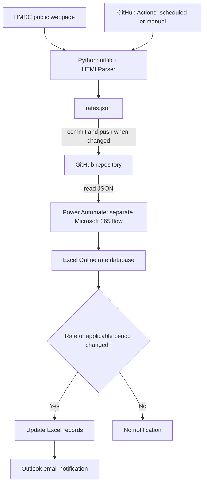

# HMRC Official Rates of Interest Monitor

A practical, rule-based automation project for monitoring HMRC's published Official Rates of Interest (ORI). It combines a Python script and GitHub Actions with a separately configured Microsoft Power Automate workflow to notify accounting staff when monitored values change.

> **Scope:** This is an automation project, not an AI-powered application or a substitute for professional tax review.

## Why this project exists

HMRC Official Rates of Interest are relevant to the tax treatment of certain beneficial loans, including some employer-provided and director loans. Checking the HMRC publication manually is repetitive and risks overlooking an update. This project automates a daily check and provides a structured record that a separate notification workflow can consume.

**Official source:** [HMRC – Beneficial loan arrangements: official rates](https://www.gov.uk/government/publications/rates-and-allowances-beneficial-loan-arrangements-hmrc-official-rates/beneficial-loan-arrangements-hmrc-official-rates)

## What it monitors

- **Average Official Rate:** The latest published rate and associated tax-year period.
- **Actual Official Rate:** The latest published rate and its effective date.
- **Changes:** Differences in either the rate or its associated period/date.

The current values are saved in [`rates.json`](rates.json). This file is a monitoring record, **not** a guarantee that the published values are current at the moment someone views the repository.

## Architecture



**Important:** The Power Automate, Excel Online and Outlook components are configured outside this repository. Their configuration is not published here and cannot be reproduced from the source files alone.

## How the GitHub component works

1. [`.github/workflows/monitor.yml`](.github/workflows/monitor.yml) starts the workflow on a schedule or via a manual trigger.
2. The workflow checks out the repository and installs Python 3.12.
3. [`monitor.py`](monitor.py) requests the public HMRC webpage with `urllib.request` and a 30-second timeout.
4. A custom `HTMLParser` extracts HTML table cells. The script reads the first data row from the first two tables: Average Rate from the first table, Actual Rate from the second.
5. The script compares the extracted values and dates/periods against the existing [`rates.json`](rates.json).
6. If anything differs, the script rewrites `rates.json`. GitHub Actions then commits and pushes that file; otherwise it reports that no update is required.

The GitHub Actions schedule is currently:

```yaml
on:
  workflow_dispatch:
  schedule:
    - cron: '17 0 * * *'
```

This requests a daily run at **00:17 UTC**. GitHub-hosted scheduled workflows can start later than the requested time; this is not a guaranteed execution deadline.

### Stored data format

The JSON file follows this structure (values shown are an example from the reviewed repository snapshot):

```json
{
  "actual": {
    "rate": 3.75,
    "effective_date": "6 April 2026"
  },
  "average": {
    "rate": 3.75,
    "period": "2025 to 2026"
  }
}
```

## Microsoft 365 notification workflow

In the separately configured deployment, Power Automate runs at **08:00 UK local time**. It retrieves `rates.json` from GitHub, compares both monitored entries against an Excel Online table, updates changed records and sends an Outlook notification only if a difference is found.

The email includes the previous and new values, the applicable date or period, and a link to the HMRC source. Recipients are configured within Microsoft 365 rather than in the public repository.

**Timing caveat:** If GitHub Actions runs late, the 08:00 Power Automate check may read the previous JSON values and detect the update only at a later run.

## Technology

| Component | Role |
| --- | --- |
| Python 3.12 | Retrieve, parse and compare published information |
| Python standard library | `urllib.request`, `html.parser`, `json`, `pathlib` |
| GitHub Actions | Daily/manual execution and committing changed JSON |
| JSON | Store the last successfully extracted values |
| Power Automate | Separately configured comparison and notification workflow |
| Excel Online | Store monitored values used by the Microsoft 365 workflow |
| Outlook | Deliver change alerts |

The Python component uses **HTML scraping**, not an HMRC API or an AI model. No third-party Python packages are required by the current script.

## Running the Python monitor locally

From the repository root, with Python installed:

```bash
python monitor.py
```

The script requires internet access to the HMRC webpage and expects `rates.json` to exist in the current working directory. It prints the extracted rates and comparison results to the console, and **may modify `rates.json`** if it detects a change. Review the resulting file diff before committing changes manually.

The GitHub workflow can also be started from **Actions → HMRC ORI Monitor → Run workflow** (subject to repository permissions).

## Testing and observed behaviour

During development, the following scenarios were tested in the integrated deployment:

| Scenario | Observed result |
| --- | --- |
| No change in monitored values | No notification sent |
| Actual Rate differs from Excel record | Record updated and notification generated |
| Average Rate differs from Excel record | Record updated and notification generated |
| Seven scheduled runs reviewed in November 2026 | Both GitHub Actions and Power Automate showed successful runs during the reviewed period |
| Excel Online connector returned HTTP 429 | Power Automate retried and the operation subsequently succeeded |

These are **historical observations**, not a guarantee of ongoing availability or proof of a complete end-to-end security review. The Microsoft 365 flow and its run history are not included in this public repository.

## Known limitations and risks

- **Fragile HTML assumptions:** The parser assumes that the first two HTML tables and their second rows contain the desired values. Changes to HMRC page layout may cause extraction failures or incorrect results.
- **Limited validation:** The script converts selected cells to floating-point values but does not independently verify the extracted results against a second official source.
- **Error handling:** Network failures, missing files, unexpected table layouts or invalid data can stop the script. The current code does not implement dedicated exception handling or failure notifications.
- **Scheduling delays:** GitHub Actions may start later than requested, and Power Automate may read data before a delayed GitHub run completes.
- **Connector throttling:** Microsoft 365 connectors may return temporary errors, including HTTP 429; successful retries are not guaranteed.
- **Limited tax scope:** The monitor does not assess the tax implications of a rate change or track all HMRC announcements.

Any figures used for tax calculations should be checked against the official HMRC publication and the applicable rules.

## Security and privacy

The checked-in files in the reviewed repository snapshot contain public HMRC data and monitoring code, not Microsoft 365 credentials or client records. This observation **does not** constitute a full audit of Git history, repository settings, GitHub Actions logs, or external Microsoft 365 connections.

Do not commit access tokens, passwords, private client data, or Microsoft connection details. Use appropriate access controls and secret-management facilities for any future integrations.

## Future development

Possible enhancements include:

- More resilient HTML parsing and validation of HMRC page changes.
- Explicit error alerts, execution monitoring and automated tests.
- A historical rate-change log and clearer operational dashboard.
- Better coordination between the GitHub and Microsoft 365 schedules.
- **Potential AI extension:** AI-assisted summaries of relevant HMRC guidance changes, with human verification against primary sources.

These enhancements are proposals, **not implemented features**.

## Educational context

This project connects a real accounting workflow with introductory software development concepts: Python programming, structured data, conditional logic, scheduling, integration between services, debugging and operational reliability.

It is deliberately described as **rule-based automation**. Understanding this distinction is important when exploring future AI applications: automating predefined comparisons is different from using machine learning or language models to interpret unstructured information and support professional decisions.

## References

- [HMRC – Beneficial loan arrangements: official rates](https://www.gov.uk/government/publications/rates-and-allowances-beneficial-loan-arrangements-hmrc-official-rates/beneficial-loan-arrangements-hmrc-official-rates)
- [GitHub Actions documentation](https://docs.github.com/en/actions)
- [Microsoft Power Automate documentation](https://learn.microsoft.com/en-us/power-automate/)

---

**Status:** Implemented and tested as an automation prototype; ongoing monitoring and reliability improvements remain necessary.
